# Hi 👋, I'm Gireesh Sadanand Patgar

<h3 align="center">AI & ML Engineering Student | Machine Learning Enthusiast | Software Developer</h3>

  

  

  <picture>
    <source media="(prefers-color-scheme: dark)" srcset="https://raw.githubusercontent.com/gireeshpatgar17/gireeshpatgar17/output/github-contribution-grid-snake-dark.svg"/>
    <source media="(prefers-color-scheme: light)" srcset="https://raw.githubusercontent.com/gireeshpatgar17/gireeshpatgar17/output/github-contribution-grid-snake.svg"/>
    
  </picture>

---

## 💫 About Me

- 🎓 Pursuing B.E. in Computer Science – Artificial Intelligence & Machine Learning.
- 🔭 Building practical AI/ML applications and software development projects.
- 🌱 Exploring Machine Learning, Deep Learning, Generative AI and Agentic AI.
- 💻 Practising Data Structures and Algorithms using C++.
- 🚀 Participating in hackathons and developing solutions to real-world problems.
- 🎯 Interested in AI/ML Engineering and Software Development.

## 🌐 Connect with Me

  
  
  
  

## 💻 Tech Stack

### Programming Languages

  
  
  
  

### Web Development

  
  
  

### Frameworks & Tools

  
  
  
  

### Areas of Interest

  
  
  
  
  

---

## 📊 GitHub Statistics

<!-- Top Languages -->

  

<!-- GitHub Contribution Streak -->

  

<!-- GitHub Activity Graph - Generated and hosted in this repository -->

  

---

  <b>✨ Building. Learning. Innovating. ✨</b>

  <i>"Great things are built one project at a time."</i>

